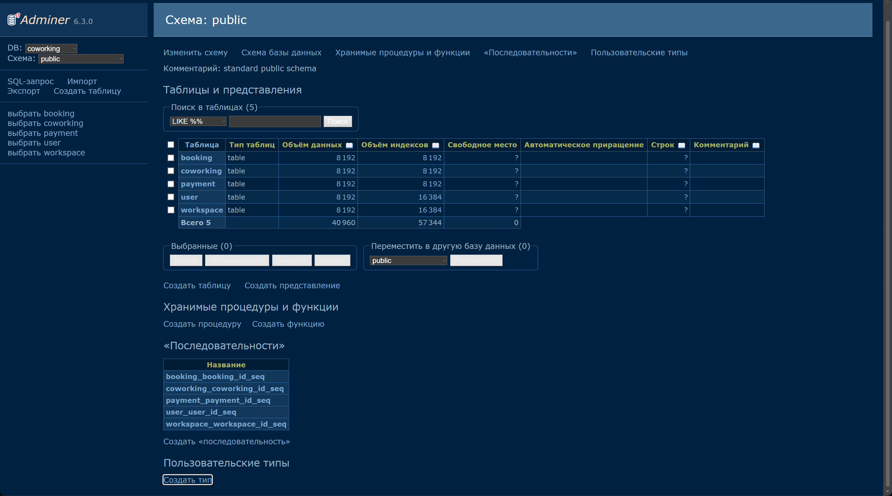
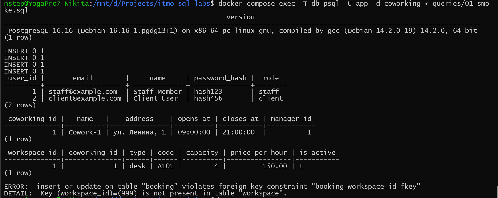
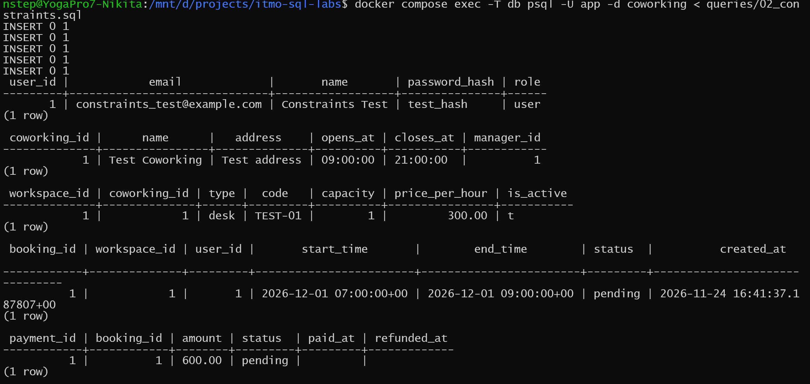
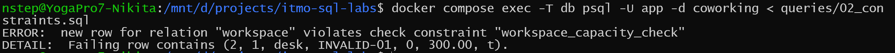

# Проект: Платформа бронирования коворкингов

Анализ требований в [requirements.md](docs/requirements.md)

## Выбор СУБД

|Критерий | PostgreSQL | MySQL | Oracle |
| --- | --- | --- | --- |
| Модель данных и поддержка JSONB | Объекто-реляционная. Есть нативная поддержка JSONB, индексация и поиск по ключам | Реляционная. Есть только стандартный тип JSON, функционал беднее | Объектно-реляционная. Поддержка только JSON, синтаксис сложнее |
| Транзакции и уровни изоляции (MVCC) | Полноценный MVCC, стандартные уровни изоляции (READ COMMITTED, REPEATABLE READ, SERIALIZABLE) | Движок InnoDB поддерживает MVCC и транзакции. По умолчанию REPEATABLE READ | Полноценный MVCC, стандартные уровни изоляции |
| Ограничение целостности (FK, CHECK, exclusion) | Есть FK, CHECK, UNIQUE. Также есть EXCLUDE - ограничение пересечения значений в таблице | FK и CHECK. Exclusion нет, проверка возможна через триггеры или на уровне приложения | Также, как и в MySQL |
| RLS и безопасность | Втроенный RLS, политики ограничения видимости строк на уровне БД | Нет нативного RLS, разграничение доступа через представления и фильтрацию | Есть аналог RLS, настройки через DBMS_RLS |
| Экосистема и инструменты | Есть EXPLAIN с подробным планом запроса. В конфиге можно включить pg_stat_statements. psql доступен в контейнере | Также есть EXPLAIN, но менее информативный, без доп. настроек. Мощная performance schema, но нужна настройка | EXPLAIN PLAN и AWR, но AWR требует лицензии Diagnostics Pack |
| Стоимость / облако | Open Source, бесплатно. Можно поднять в облаке — один из самых дешёвых вариантов. Есть managed варианты | Open Source, бесплатно. В облаке сопоставим с PostgreSQL | Коммерческая лицензия. В облаке Oracle обычно дороже при сопоставимой мощности |

### Вывод

Для проекта оптимальным выбором будет PostgreSQL. 

Во-первых, декларативно можно закрыть граничный случай по пересечению времени броней через `EXCLUDE` на уровне схемы. В других сравниваемых варианта такого механизма нет.

Во-вторых, RLS совпадает с распределением ролей. Требования по видимости данных из анализа настраивается политикой на уровне БД. Подобная настройка есть в Oracle, однако настройка сложнее.

В-третьих, PostgreSQL бесплатный и легко поднимается в Docker контейнере. И в целом имеет более низкий порог входа.

## SQL vs NoSQL

Рассмотрим на примера граничного случая сценария 1. **Два клиента одновременно пытаются забронировать один времененной слот**. Он затрагивает три ключевые сущности: `user`, `workspace`, `booking` и связан с платежами.

### Запросы

**SQL**

1. Проверка конфликта слотов. `SELECT ... FROM booking WHERE workspace_id = ? AND status != 'cancelled' AND start_time < ? AND end_time > ?`
2. Создание брони. `INSERT INTO booking (...) VALUES (...)`
3. Запрос истории. `SELECT * FROM booking JOIN workspace ON ... WHERE user_id = ? ORDER BY created_at DESC`
4. Платеж. `INSERT INTO payment (booking_id, ...) VALUES (...)`

**NoSQL (документый подход)**

1. Проверка доступности. Чтение `resources`, проверка `bookedSlots` на пересечение интервалов
2. Создание бронирования. Запуск транзакции, повторная проверка, `updateOne` для добавления слота в `bookedSlots`, одновременно `insertOne` в коллекцию `bookings`
3. Запрос истории. `db.bookings.find({ userId: ? }).sort({ createdAt: -1 })`
4. Платеж. Либо встроенный подобъект `payment` в документе `booking`, либо отдельная коллекция с ручным поддержанием согласованности через `bookingId`

### JOIN и транзакции

**SQL**: JOIN - штатная операция. Запрос «мои бронирования + название места + статус платежа» реализуется через трёхтабличный JOIN. Транзакции охватывают несколько таблиц: вставка booking + вставка payment либо обе успешны, либо обе откатываются.

**NoSQL**: JOIN (`$lookup`) работает, но медленно и есть ограничения. Можно встроить связанные данные в один документ, но это приведет к дублированию. Мультидокументные транзакции в поддерживаются но имеют значительные накладные расходы. Рекомендуется проектировать так, чтобы операции были атомарными в рамках одного документа. Однако при этом история бронирований и платежные записи разделяются, и для запроса полной информации всё равно требуется `$lookup` или несколько запросов.

### Схема

**SQL**

```sql
-- booking
booking_id BIGSERIAL PK
workspace_id BIGINT FK → workspace
user_id BIGINT FK → user
start_time TIMESTAMPTZ NOT NULL
end_time TIMESTAMPTZ NOT NULL
status TEXT NOT NULL CHECK (status IN (...))
-- payment
payment_id BIGSERIAL PK
booking_id BIGINT FK → booking
amount NUMERIC NOT NULL CHECK (amount >= 0)
status TEXT NOT NULL
```

**NoSQL**

```javascript
// collection: resources (встроенный bookedSlots)
{
  _id: ObjectId,
  name: "A101",
  bookedSlots: [
    { bookingId: ObjectId, start: ISODate(...), end: ISODate(...) }
  ]
}
// collection: bookings
{
  _id: ObjectId,
  resourceId: ObjectId,
  userId: ObjectId,
  start: ISODate(...),
  end: ISODate(...),
  status: "confirmed"
}
```

### Вывод

Для данного проекта удобнее будет работать с SQL.
1. Целостность данных. Внешние ключи PostgreSQL обеспечивают это автоматически, а в NoSQL эквивалента нет
2. Предотвращение двойного требует согласованности. Сценарий 1 требует, чтобы только один человек получил слот. В PostgreSQL EXCLUDE-ограничение декларативно обеспечивает это на уровне БД. В NoSQL необходимо вручную реализовать «транзакция + проверка + обновление». Сложность и расходы выше
3. Объём данных не требует документной модели. NoSQL выигрывает на миллионах/десятках миллионов документов с разнородной структурой. PostgreSQL справится с прогнозируемым объёмом.
4. Отчётность и агрегация. Оконные функции и CTE SQL более естественны и читаемы, чем конвейер агрегации NoSQL.

Документная модель была бы лучше, если бы структура данных в проекте сильно различалась, и не требовалось предотвращать двойное бронирование через транзакции на уровне базы данных.

## Запуск контейнера



Контейнер запускается, adminer видит БД, [init.sql](init.sql) применяется автоматически

## Smoke-тест



Smoke-тест запускается, падает с ошибкой нарушения FK

## Constraint-тесты

Запуск положительных тестов:



Запуск одного из негативных тестов:



## Ключи

### Первичные ключи

В качестве первичных ключей используются суррогатные ключи на основе автоинкремента. Например, `user_id` и т.д. Суррогатные ключи выбраны потому, что они не зависят от бизнес-данных и остаются стабильными при изменении информации.

Можно было бы использовать естественные ключи, например, email или код рабочего места, но они могут изменяться и теоретически не всегда уникальны.

### Альтернативные ключи

В качестве альтернативных ключей можно выделить:
- user.email — **уникальный** адрес электронной почты пользователя (UNIQUE в таблице)
- (workspace.coworking_id, workspace.code) — уникальный код рабочего места в рамках конкретного коворкинга.
Эти ограничения предотвращают создание дублирующихся пользователей и рабочих мест с одинаковыми кодами внутри одного коворкинга.

### Внешние ключи

Внешние ключи обеспечивают целостность связей между сущностями. Например, бронирование не может ссылаться на несуществующее рабочее место или пользователя.

Для связанных таблиц используется ON DELETE RESTRICT, чтобы предотвратить удаление записей, на которые ссылаются другие сущности, и сохранить историю бронирований и платежей.
