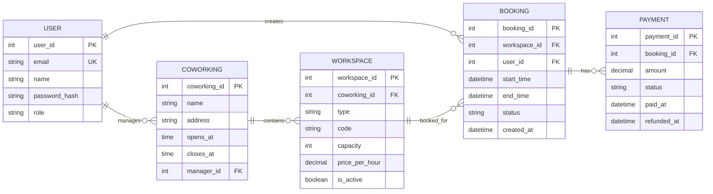

# ER-диаграмма платформы бронирования коворкингов

Диаграмма описывает сущности платформы бронирования,
их атрибуты и связи между ними.

## Особенности модели

- M:N между USER и WORKSPACE реализована через BOOKING.
- У каждой сущности есть собственный PK.
- Email пользователя является альтернативным уникальным ключом.
- Код рабочего места уникален в пределах одного коворкинга (составной AK: coworking_id + code).
- Рекурсивная связь и слабая сущность не используются, так как в текущей предметной области они не требуются.
- Многозначные атрибуты в текущей модели отсутствуют.
